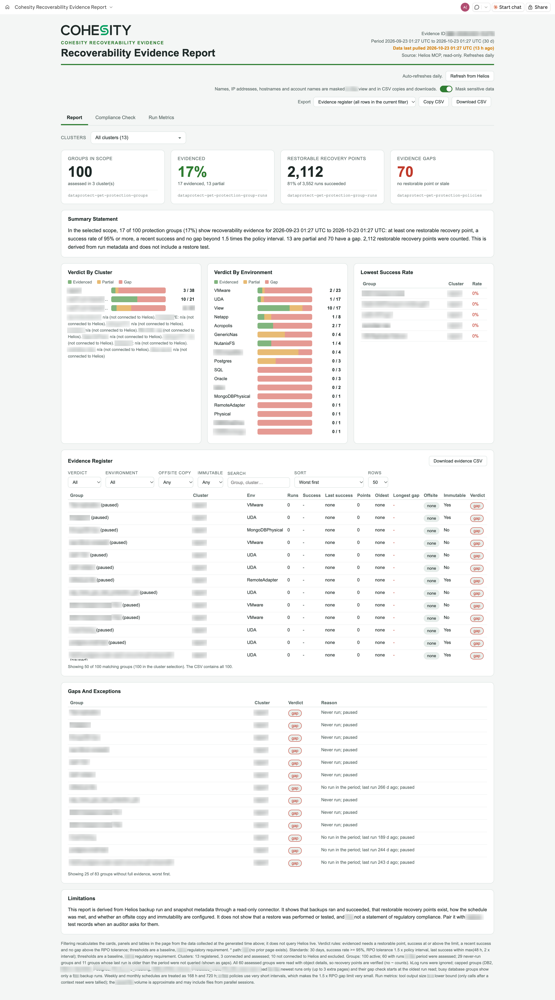
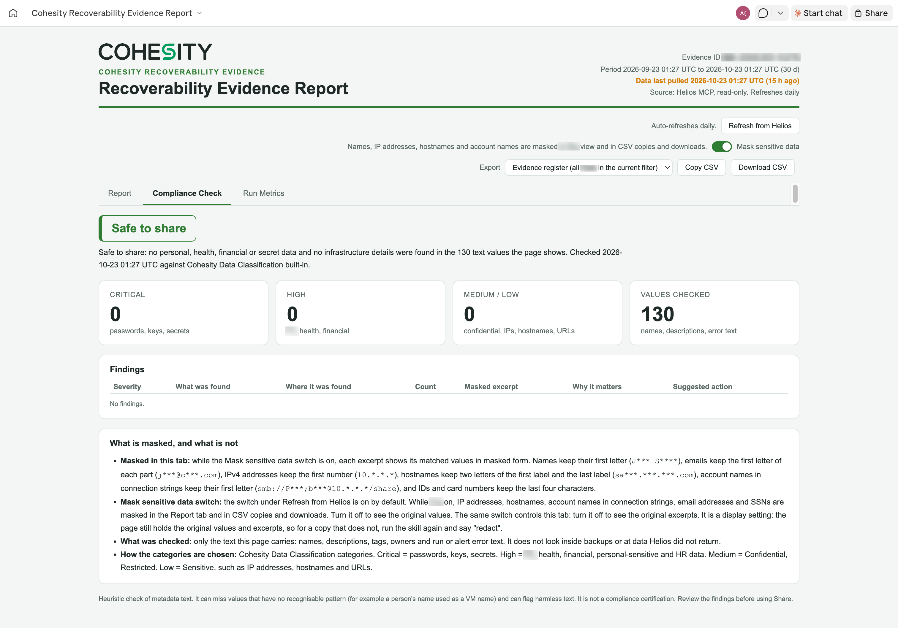
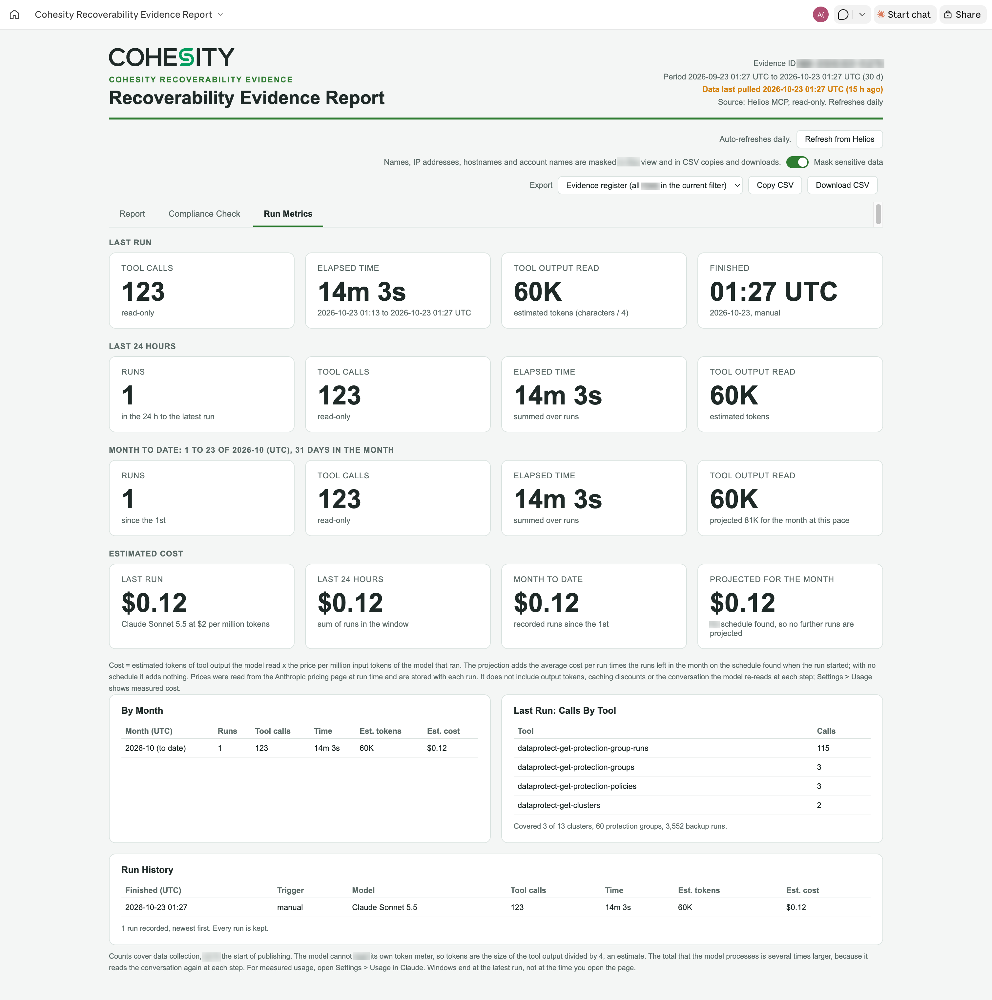

# Recoverability Evidence: Claude Sample Output

Sample output of the Claude skill [`Cohesity-Recoverability-Evidence-Report/SKILL.md`](Cohesity-Recoverability-Evidence-Report/SKILL.md). For install and use, see the [main README](../README.md). Every page has the Cohesity logo top-left and "Data last pulled" with its age top-right. Screenshots are from the published artifact; cluster and group names are lab data.

## Report

## Compliance Check

Checks the metadata shown on the page for personal data, secrets and infrastructure details before the page is shared.

## Run Metrics

Tool calls, elapsed time, estimated tokens and estimated cost for the last run, the last 24 hours and the month to date, plus the full run history.

